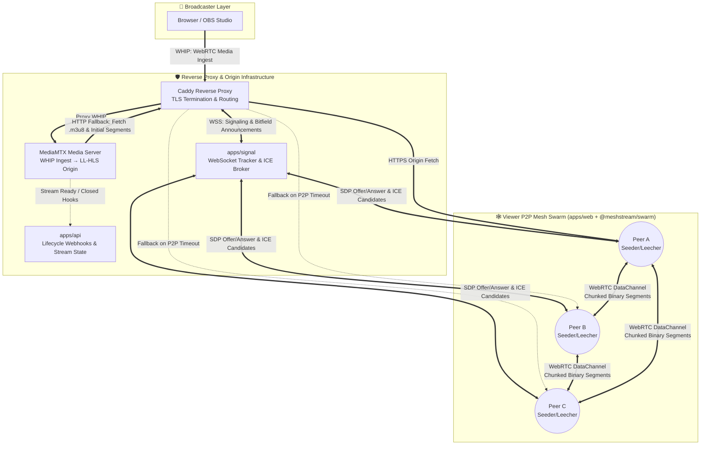

<div align="center">

# 🌐 MeshStream
**A Hybrid Peer-to-Peer (P2P) Live Video Streaming Platform Built on WebRTC DataChannels & Low-Latency HLS**

[](https://www.typescriptlang.org/)
[](https://webrtc.org/)
[](https://github.com/video-dev/hls.js/)
[](https://github.com/bluenviron/mediamtx)
[](https://caddyserver.com/)

*Offloading origin server bandwidth by transforming concurrent live-stream viewers into a self-organizing mesh distribution network.*

[Architecture](#-system-architecture) • [Networking Mechanics](#-core-networking-mechanics) • [Monorepo Structure](#-monorepo-structure) • [Getting Started](#-getting-started) • [Protocol Spec](#-signaling--wire-protocol)

</div>

---

## 📖 Overview

Traditional live video streaming relies on a centralized Client-Server (CDN) topology where $N$ concurrent viewers require $O(N)$ egress bandwidth from the origin media server. During traffic spikes, origin servers become a critical bottleneck and incur massive bandwidth costs.

**MeshStream** solves this at the application and transport layers by implementing a **Hybrid CDN + Peer-to-Peer (P2P) Mesh Architecture**:
1. **Ultra-Low Latency Ingestion:** Broadcasters publish live streams via **WHIP** (WebRTC-HTTP Ingestion Protocol) directly from the browser or OBS into **MediaMTX**.
2. **Real-Time Transmuxing:** MediaMTX transmuxes the incoming WebRTC RTP media tracks into **Low-Latency HLS (LL-HLS)** segments (`.ts` / `.m4s` and `.m3u8` manifests) without transcoding overhead.
3. **Swarm-Assisted Delivery:** Viewers join a stream room coordinated by a WebSocket signaling tracker (`apps/signal`) and establish **WebRTC DataChannels** (`SCTP` over `DTLS/UDP`) with neighboring peers via `@meshstream/swarm`.
4. **Custom HLS Loader Interceptor:** A custom `hls.js` segment loader (`hlsLoader.ts`) intercepts video segment requests, querying the P2P mesh swarm first and seamlessly falling back to the HTTP origin server if peer delivery exceeds the playback deadline.

---

## 🏗️ System Architecture



## 🧠 Core Networking Mechanics

MeshStream demonstrates key Computer Networks principles across the Transport, Session, and Application layers:

1. **WHIP Ingestion & Real-Time Transmuxing**
Instead of high-latency RTMP over TCP (which suffers from head-of-line blocking), broadcasters ingest media using WHIP (RFC 9725) over UDP. MediaMTX receives the RTP packets and repackages the H.264/Opus payloads into fragmented MP4 / MPEG-TS segments for HLS delivery.

2. **WebSocket Tracker & Mesh Topology Formation (apps/signal)**
When a viewer opens a stream, the client connects to the WebSocket signaling server and joins a logical swarm room tied to the streamId:

- **Peer Discovery:** The tracker returns a bounded subset of active peer IDs in the room to prevent full-mesh connection explosion, maintaining an optimal peer degree ($k$-regular mesh).
- **NAT Traversal:** Peers exchange SDP Offers/Answers and trickle ICE Candidates (STUN/TURN) through the tracker to punch holes through NATs and firewalls.
- **Segment Availability (Bitfield/Have Maps):** As peers download segments (either from the HTTP origin or other peers), they broadcast HAVE announcements over the mesh so neighbors maintain a local map of which peers hold which segment URIs.

3. **Chunked Binary Transfer over WebRTC DataChannels (@meshstream/swarm)**
WebRTC DataChannels run on SCTP (Stream Control Transmission Protocol) tunneled over DTLS/UDP. Because SCTP enforces a maximum message size limit (typically 16 KB – 64 KB across browser implementations) while video segments range from 500 KB to 4 MB:

- **Fragmentation & Reassembly:** @meshstream/swarm slices outgoing ArrayBuffer video segments into fixed-size binary chunks (e.g., 16 KB) tagged with a header containing the segment ID, chunk index, and total chunk count.
- **Backpressure Control:** Uses `RTCDataChannel.bufferedAmount` and `bufferedamountlow` events to prevent SCTP send-buffer overflow during high-bitrate transfers.
- **In-Memory LRU Cache:** Each peer caches recently decoded segments in a bounded LRU ring buffer to serve incoming peer requests without exhausting browser memory.

4. **Hybrid Segment Scheduling & HTTP Fallback (hlsLoader.ts)**
Live streaming has strict real-time playback deadlines. The custom hls.js loader implements a deterministic race/fallback policy:

- **m3u8 Playlists:** Always fetched directly from the HTTP Origin via Caddy to guarantee fresh sliding-window manifest state.
- **Media Segments (.ts / .m4s):**
  1. **Swarm Lookup:** Query @meshstream/swarm for connected peers advertising the requested segment URI.
  2. **P2P Fetch with Deadline:** Issue a `SEGMENT_REQ` over the lowest-RTT DataChannel and start a strict timeout timer (tuned to buffer health).
  3. **Origin Fallback:** If no peer holds the segment, the peer disconnects mid-transfer, or the P2P transfer exceeds the timeout threshold, `hlsLoader.ts` immediately aborts the P2P request and fetches the segment via standard `fetch()` from the MediaMTX HTTP origin.
- **Telemetry Tracking:** Every resolved byte is categorized as `p2pBytes` or `httpBytes`, dynamically computing the live P2P Offload Ratio (%) and active mesh topology on the client dashboard.

## 📂 Monorepo Structure

```text
meshstream/
├── apps/
│   ├── web/                    # Frontend Client (Stream Player, Broadcaster UI, Swarm Telemetry)
│   │   └── src/
│   │       ├── hlsLoader.ts    # Custom hls.js loader intercepting segment requests for P2P/HTTP
│   │       └── ...             # UI components, real-time offload graphs & player bindings
│   ├── signal/                 # WebSocket Signaling Server & Swarm Tracker
│   │   └── src/                # Room registry, peer matchmaking, SDP/ICE relay broker
│   └── api/                    # Backend Control Plane & MediaMTX Webhook Receiver
│       └── src/                # Stream lifecycle hooks (onPublish, onUnpublish) & stream metadata
├── packages/
│   ├── protocol/               # (@meshstream/protocol) Shared TypeScript signaling schemas & wire types
│   └── swarm/                  # (@meshstream/swarm) WebRTC PeerConnection pool, DataChannel chunking & LRU cache
├── Caddyfile                   # Reverse proxy routing (/whip, /hls, /ws, /api) & local TLS termination
├── mediamtx.yml                # MediaMTX configuration for WHIP ingest, LL-HLS muxing & webhook triggers
├── package.json                # Workspace root scripts & dependency definitions
└── tsconfig.base.json          # Shared TypeScript compiler configuration
```

## 📡 Signaling & Wire Protocol (@meshstream/protocol)

All control communication between clients and apps/signal is strictly typed via @meshstream/protocol.

### Signaling Messages (WebSocket JSON)

| Message Type | Direction | Description |
|--------------|-----------|-------------|
| JOIN_ROOM | Client → Tracker | Registers peer in a streamId swarm room and requests an initial peer list. |
| PEER_LIST | Tracker → Client | Returns active peer IDs currently participating in the stream swarm. |
| PEER_JOINED / PEER_LEFT | Tracker → Client | Notifies connected peers of swarm churn to rebalance mesh connections. |
| SIGNAL_OFFER | Peer → Tracker → Peer | Relays WebRTC `RTCSessionDescriptionInit` (SDP Offer) to target peer. |
| SIGNAL_ANSWER | Peer → Tracker → Peer | Relays WebRTC `RTCSessionDescriptionInit` (SDP Answer) to initiating peer. |
| SIGNAL_ICE | Peer → Tracker → Peer | Relays trickle `RTCIceCandidateInit` payloads for NAT traversal. |

### DataChannel Wire Messages (Peer-to-Peer)

| Message Type | Payload Format | Description |
|--------------|---------------|-------------|
| HAVE | JSON Control | Broadcasts newly cached segment URI (segmentId) to connected neighbors. |
| SEGMENT_REQ | JSON Control | Requests a specific segmentId from a neighbor advertising availability. |
| SEGMENT_CHUNK | Binary (ArrayBuffer) | Header + 16 KB slice of the requested media segment. |
| SEGMENT_NOT_FOUND | JSON Control | Immediate NACK if the segment was evicted from the peer's LRU cache, triggering immediate HTTP fallback. |

## 🚀 Getting Started

### Prerequisites

- Node.js (v18+ recommended)
- MediaMTX binary installed or placed in the project root/PATH
- Caddy installed for unified reverse-proxy routing and HTTPS/WSS local termination

### 1. Clone & Install Dependencies

```bash
git clone https://github.com/Arp1tSingh/meshstream.git
cd meshstream
npm install
```

### 2. Build Shared Packages

Build @meshstream/protocol and @meshstream/swarm so the apps can consume their compiled artifacts:

```bash
npm run build --workspaces --if-present
```

### 3. Start the Infrastructure & Services

Launch the MediaMTX server, Caddy reverse proxy, backend services (apps/signal, apps/api), and frontend (apps/web). If using the included orchestration scripts on Windows/PowerShell:

```powershell
# Start all services (MediaMTX, Caddy, API, Signal Tracker, and Web UI)
.\start.ps1
```

(Alternatively, run each workspace service in separate terminals):

```bash
# Terminal 1: Media Server
mediamtx mediamtx.yml

# Terminal 2: Signaling Tracker
npm --workspace=apps/signal run dev

# Terminal 3: API & Webhook Server
npm --workspace=apps/api run dev

# Terminal 4: Web Frontend
npm --workspace=apps/web run dev

# Terminal 5: Reverse Proxy
caddy run --config Caddyfile
```

## 🧪 Testing the P2P Swarm Locally

### Start Broadcasting

Open the broadcaster view in your browser (or configure OBS Studio with Service: WHIP pointing to the Caddy/MediaMTX WHIP ingest endpoint, e.g., `https://localhost/whip/<stream-key>`).

Start streaming video. apps/api will register the stream via MediaMTX's runOnReady hook.

### Spawn the Viewer Swarm

Open Tab 1 (Peer A) at the viewer URL. Since Peer A is the first viewer in the room, 100% of its segments will be fetched via HTTP Origin. Peer A immediately caches these segments in @meshstream/swarm.

Open Tab 2 (Peer B) and Tab 3 (Peer C) to the same stream URL.

### Observe Bandwidth Offloading

Watch the real-time network telemetry dashboard on Peer B and Peer C.

After the initial WebRTC DataChannel handshake completes via apps/signal, `hlsLoader.ts` will begin pulling video segments directly from Peer A's memory cache over RTCDataChannel.

Verify in DevTools (chrome://webrtc-internals or the Network tab) that `.ts` / `.m4s` segment transfers drop off the HTTP network waterfall and flow across the WebRTC DataChannel.

## 📊 Key Computer Networks Concepts Demonstrated

- **Application-Layer Multicast (ALM):** Constructing an overlay network on top of unicast links so viewers relay live video payloads without router-level IP Multicast support.
- **Transport Layer Trade-offs (TCP vs. UDP/SCTP):** Combining TCP/TLS for reliable manifest and signaling delivery with UDP-based WebRTC (RTP for ingest, SCTP/DTLS for DataChannels) to eliminate TCP head-of-line blocking across peer links.
- **NAT Traversal & ICE (RFC 8445):** Interactive Connectivity Establishment using STUN/TURN candidate gathering and SDP negotiation.
- **Hybrid Edge-P2P Scheduling:** Balancing P2P offload efficiency against strict real-time playback QoS constraints through deadline-aware HTTP fallback.

## 👤 Author

Arpit Singh

GitHub: @Arp1tSingh

## 📄 License

This project is licensed under the MIT License.
